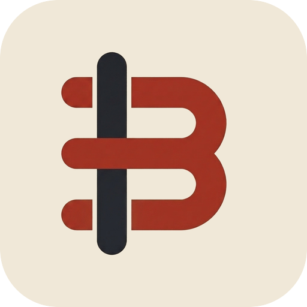

<p align="center">
  
</p>

<h2 align="center">Bobbin</h2>

<p align="center">
  <em>The SDK for building custom integrations and extensions for Heddle.</em>
</p>

<p align="center">
  <a href="https://hex.pm/packages/bobbin"></a>&nbsp;
  <a href="https://hexdocs.pm/bobbin"></a>&nbsp;
  <a href="https://github.com/heddlehq/Bobbin/blob/main/LICENSE"></a>&nbsp;
  <a href="https://github.com/heddlehq/Bobbin"></a>&nbsp;
  <a href="https://discord.gg/7zjnpna239"></a>
</p>

---

> [!IMPORTANT]
> **Status:** This project is currently in active development.

**Bobbin** is an Elixir SDK for building custom integrations and extensions for **Heddle**. It provides the tools to simplify the development of nodes and real-time workflows.

## 🚀 Getting Started

Add `bobbin` to your dependencies in `mix.exs`:

```elixir
def deps do
  [
    {:bobbin, "~> 0.2"}
  ]
end
```

To write your first node, read **[Writing a node](https://hexdocs.pm/bobbin/writing-a-node.html)**. The reference is on **[HexDocs](https://hexdocs.pm/bobbin)**, and how to use Heddle's own nodes is in the **[Heddle documentation](https://heddlehq.github.io/website/docs/)**.

## 🤝 Community & Contributing

We believe in building in public. Join our community to discuss ideas, track our vision, or help us build:

- **Discord**: Join our [Discord Server](https://discord.gg/7zjnpna239) for support.
- **GitHub**: Contribute via [GitHub Issues](https://github.com/heddlehq/Bobbin/issues).

## License

Bobbin is open-source software licensed under the [MIT license](LICENSE).
