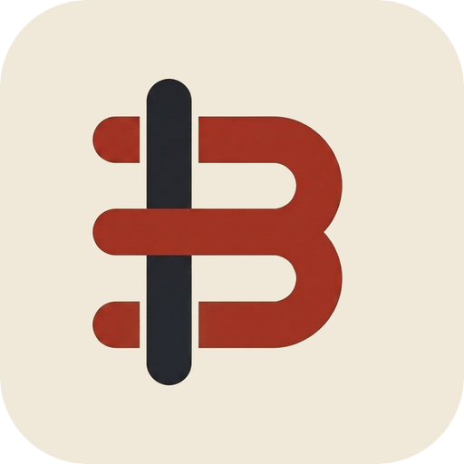

<p align="center">
  
</p>

<h2 align="center">Bobbin</h2>

<p align="center">
  <em>The SDK for building custom integrations and extensions for Heddle.</em>
</p>

<p align="center">
  <a href="https://hex.pm/packages/bobbin"></a>&nbsp;
  <a href="https://hexdocs.pm/bobbin"></a>&nbsp;
  <a href="https://github.com/heddlehq/Bobbin/blob/main/LICENSE"></a>&nbsp;
  <a href="https://github.com/heddlehq/Bobbin"></a>&nbsp;
  <a href="https://discord.gg/7zjnpna239"></a>
</p>

---

> [!IMPORTANT]
> **Status:** This project is currently in active development.

**Bobbin** is an Elixir SDK for building custom integrations and extensions for **Heddle**. It provides the tools to simplify the development of nodes and real-time workflows.

## 🚀 Getting Started

Add `bobbin` to your dependencies in `mix.exs`:

```elixir
def deps do
  [
    {:bobbin, "~> 0.5"}
  ]
end
```

For detailed documentation, visit **[HexDocs](https://hexdocs.pm/bobbin)**.

## Integrations without code

Most integrations are a set of HTTP calls. Write them as a YAML manifest and each
action becomes a node in Heddle, with a `success` and an `error` output:

```bash
mix bobbin.new acme_crm                     # writes acme_crm.yaml to fill in
mix bobbin.validate acme_crm.yaml           # says what is wrong, if anything
mix bobbin.run acme_crm.yaml "Get Item" \
  --field id=42 --credential api_key=$KEY   # runs an action against the real API
```

```yaml
id: acme_crm
name: Acme CRM
version: 1.0.0
base_url: https://api.acme.test/v1/

credential:
  fields:
    - {name: api_key, label: API key, secret: true}
  auth: {type: bearer, token: "{{credential.api_key}}"}

actions:
  - name: Get Item
    fields:
      - {name: id, label: Item ID}
    request: {method: GET, path: "items/{{fields.id}}"}
    output: {pick: [id, name]}

triggers:
  - name: New Item
    request: {method: GET, path: items}
    output: {path: data}
    poll: {every: 5, id: id}   # starts the flow once for each item it hasn't seen
```

Requests are built with `{{fields.<name>}}` and `{{credential.<name>}}`, empty values
are left out, and pagination comes in three presets: `cursor`, `offset` and `link`.
The [manifest guide](https://hexdocs.pm/bobbin/manifest.html) walks through each part,
`Bobbin.Integration` has the whole format, and
[`priv/integration.schema.json`](https://github.com/heddlehq/Bobbin/blob/main/priv/integration.schema.json) for editors that read
JSON Schema.

For what a manifest can't express, like a database driver, write the nodes in Elixir
with `Bobbin.Node` and `Bobbin.Service`: the credential, the `success` and `error`
outputs, templates and files work as in Heddle's own nodes, and `Bobbin.Connections`
keeps a driver's connection open between runs. The host (Heddle) plugs in through
`Bobbin.Host`. See [Integrations in Elixir](https://hexdocs.pm/bobbin/packages.html).

## 🤝 Community & Contributing

We believe in building in public. Join our community to discuss ideas, track our vision, or help us build:

- **Discord**: Join our [Discord Server](https://discord.gg/7zjnpna239) for support.
- **GitHub**: Contribute via [GitHub Issues](https://github.com/heddlehq/Bobbin/issues).

## License

Bobbin is open-source software licensed under the [MIT license](https://github.com/heddlehq/Bobbin/blob/main/LICENSE).
